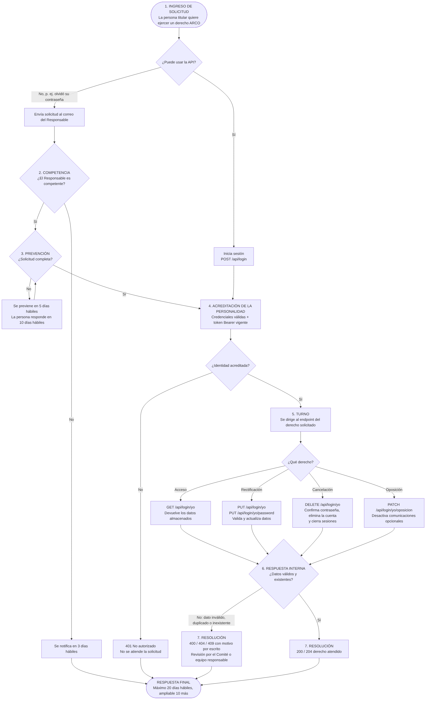
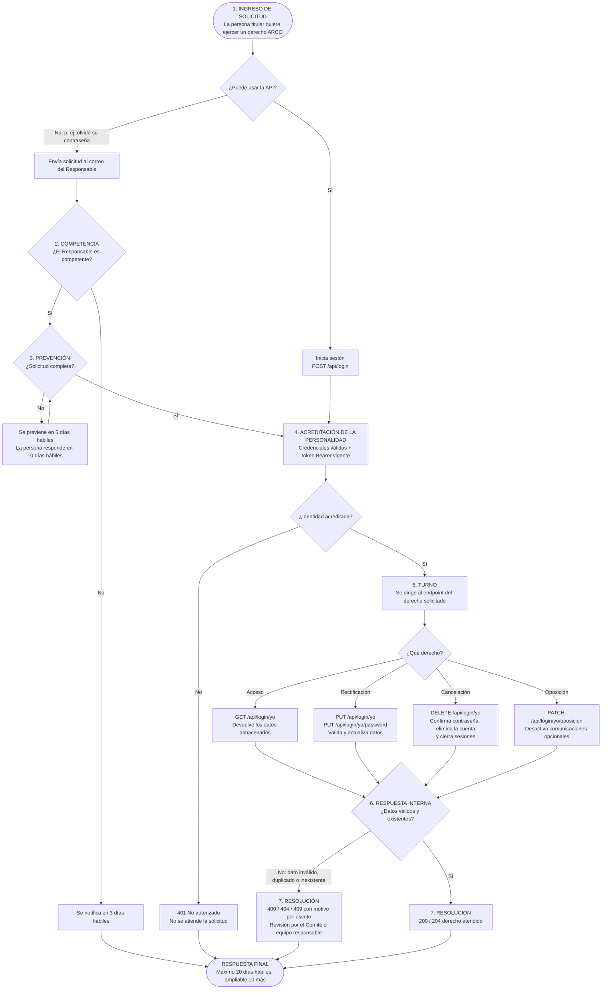

# Diagrama de flujo — Derechos ARCO en el proyecto

Basado en el procedimiento para gestionar una solicitud ARCO (página 13 del PDF): ingreso, competencia, prevención, acreditación de la personalidad, turno, respuesta interna / Comité, resolución y respuesta final.

